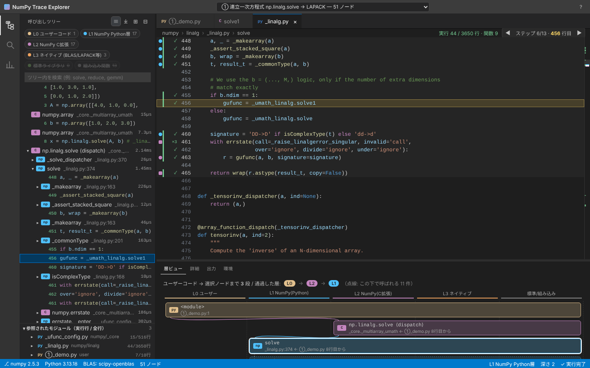

# py_structure1 — NumPy Trace Explorer

Python のコードを実際に実行して、**NumPy がどのモジュールの何行目を通り、どの C 拡張・BLAS/LAPACK まで降りて計算しているか**を記録し、VS Code 風のビューアで層ごと・行ごとに辿れるようにするツールです。



- **デモ（GitHub Pages）**: `https://shin22s-lab.github.io/py_structure1/`（Pages を有効化した後に公開）
- **ツール本体**: [`numpy_trace.py`](numpy_trace.py)（1 ファイル。Python 3.12 以上 + NumPy）

## 何が見えるか

| 層 | 中身 | 表示されるもの |
|---|---|---|
| **L0** ユーザーコード | トレースしたスクリプト | ソース、実行した行 |
| **L1** NumPy Python 層 | `numpy/**/*.py` | **実際のソース**、関数の範囲、実行した行と回数、実行順 |
| **L2** NumPy C 拡張 | `_multiarray_umath` などの `.so` | ufunc の型ループ、共有ライブラリの場所、docstring、対応する C ソース（目安） |
| **L3** ネイティブ | OpenBLAS / LAPACK / pocketfft など | 呼ばれるルーチン名（**推定**。例: `dgesv`, `cblas_dgemm`） |
| 標準ライブラリ・組み込み | NumPy 内部から呼ばれたもの | 既定では非表示（チップで切り替え） |

例: `np.linalg.solve(A, b)` は次のように降りていきます。

```text
L0 x = np.linalg.solve(A, b)                       demo.py 8行目
 └ L2 np.linalg.solve ⟨__array_function__ dispatch⟩
    └ L1 solve                                     numpy/linalg/_linalg.py:374
       ├ 448  a, _ = _makearray(a)
       ├ 456  gufunc = _umath_linalg.solve1
       └ 463  r = gufunc(a, b, signature=signature)
          └ L2 gufunc solve1                       numpy/linalg/_umath_linalg.*.so
             └ L3 LAPACK dgesv (推定)              scipy-openblas
```

## 使い方

```bash
pip install numpy                                  # NumPy 2.x 推奨
python numpy_trace.py my_script.py -o trace.html   # スクリプトをトレース
python numpy_trace.py -c "import numpy as np; np.linalg.svd(np.ones((4,4)))" -o t.html
python numpy_trace.py --demo -o demo.html          # 組み込みデモ 9 本
```

出力された HTML はサーバー不要で、ブラウザでそのまま開けます。

| オプション | 説明 |
|---|---|
| `-o FILE` | 出力 HTML（既定 `numpy_trace.html`） |
| `-c CODE` | ファイルではなくコード文字列をトレース |
| `--demo` | 組み込みデモ（solve / 行列積 / mean / eigh・svd / FFT / 乱数 / 統計 / einsum / 総合） |
| `--no-lines` | 実行行を記録しない（軽量化） |
| `--no-stdlib-source` | Python 標準ライブラリのソースを HTML に埋め込まない（公開用） |
| `--user-path DIR` | L0 として扱う追加ディレクトリ（スクリプトと同じフォルダは自動） |
| `--max-nodes N` | 記録するノード数の上限（既定 30000） |
| `--json FILE` | 生データを JSON でも保存 |
| `script.py args...` | スクリプトへの引数。`--` 以降はすべてスクリプトに渡す |

## ビューアの操作

- **呼び出しツリー（左）**: 関数を開くと、**実行した行が行番号つきで実行順に**並び、その行から呼ばれた関数がすぐ下に入ります（`≡` で行表示の ON/OFF）。行をクリックするとエディタのその行へ移動します。
- **エディタ（中央）**:
  - 薄い緑のバー: このトレースでそのモジュール内で実行された行
  - 濃い緑のバーと `×回数`: 選択中の関数が実行した行
  - `●`: さらに下の呼び出しがある行（色は降りる先の層）。行番号をクリックすると潜れます
  - 上部の `◀ ▶`（キー `p` / `n`）: 実行順に 1 行ずつステップ
- **参照されたモジュール（左下）**: `▸` を開くと、そのファイルで呼ばれた関数の行範囲と実行行数・呼び出し回数が出ます。
- **層ビュー（下）**: ユーザーコードから選んだ関数までの経路を層のレーンで表示し、各段が呼び出し元の何行目から来たかも表示します。
- 🔍 で関数検索、📊 で層ごとの自己時間とホットスポットを確認できます。スマホではツリー / コード / 層ビューをタブで切り替えます。

## 仕組み

- Python 3.12 の [`sys.monitoring`](https://docs.python.org/3/library/sys.monitoring.html) で `PY_START` / `PY_RETURN` / `CALL` / `C_RETURN` / `LINE` などのイベントを受け取り、NumPy とユーザーコードに関係する呼び出しだけを木にします。
- ユーザーコード中の演算子（`a @ b`、`a + b`、比較、単項演算）は AST を書き換えて関数呼び出しにし、`ndarray.__matmul__ → ufunc matmul` のように見えるようにしています。
- L3 は、C 拡張の gufunc 名と引数の dtype から LAPACK/BLAS のルーチン名を推定しています（例: `solve1` × `float64` → `dgesv`）。BLAS/LAPACK のライブラリ名とバージョンは `np.show_config()` から取得しています。

## 制約

- C 拡張の**内部**は追跡できません（観測できるのは C 関数の入口まで）。L3 の名前は推定です。
- `a[i]`、`a += b`、ユーザーが自作した別モジュール内の演算子は記録されません。
- 実行行は関数あたり最大 3000 件まで記録します。`import` 時に実行されるモジュール直下のコードは対象外です。
- 表示される時間にはトレース自体のオーバーヘッドが含まれるため、相対的な目安です。

## リポジトリ構成

```text
index.html               GitHub Pages 用デモ（tools/build.py --demo で生成）
numpy_trace.py           配布用の単一ファイル（tools/build.py で生成）
src/tracer_core.py       トレーサー本体
src/cli_part.py          CLI とデモ
src/viewer_template.html ビューア（HTML/CSS/JS、外部依存なし）
tools/build.py           上の 3 つを結合 → numpy_trace.py / index.html / THIRD_PARTY_NOTICES.md
```

`src/` を編集したら `python tools/build.py --demo` で再生成してください。

## GitHub Pages で公開する

Settings → Pages → *Deploy from a branch* で `main` / `/ (root)` を選ぶと、`index.html` が公開されます。リポジトリが private でも、Pages のサイトは誰でも閲覧できる状態になる点に注意してください。

## ライセンス

- このリポジトリのコード（`numpy_trace.py`, `src/`, `tools/`）: [MIT License](LICENSE)
- `index.html`（と、このツールで生成した HTML）には **NumPy のソースコードと docstring** が含まれます。これらは NumPy Developers の著作物で、**BSD 3-Clause License**（`numpy/ma` などの一部サブパッケージは各自のライセンス）に従って再配布しています。条文は [THIRD_PARTY_NOTICES.md](THIRD_PARTY_NOTICES.md) と、生成した HTML の中（`?` ヘルプ / 環境タブ → ライセンス）に入れてあります。生成した HTML を公開するときは、この表記を残してください。
- Python 標準ライブラリのソースは公開用デモには含めていません。OpenBLAS / LAPACK などはルーチン名を表示するだけで、コードは含みません。
- このプロジェクトは NumPy・Python の公式プロジェクトではなく、それらの開発元とは関係ありません。
